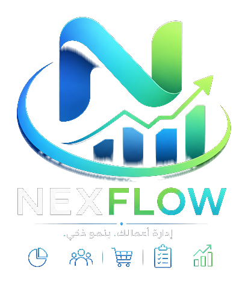

<div align="center">



# NexFlow — نظام نقطة البيع

**نظام كاشير ذكي للمشاريع المصرية الصغيرة والمتوسطة**

[](https://nextjs.org/)
[](https://www.typescriptlang.org/)
[](https://tailwindcss.com/)
[](https://www.prisma.io/)
[](./LICENSE)

---

**صفحة تسويقية احترافية باللغة العربية RTL لنظام NexFlow POS**

[🚀 عرض مباشر](#) · [📞 تواصل معنا](https://wa.me/201508051588) · [🐛 الإبلاغ عن مشكلة](https://github.com/Moahmed-Mahmoud-Mahdy/NexFlow/issues)

</div>

---

## 📋 نظرة عامة

**NexFlow** هو نظام نقطة بيع (POS) متكامل مصمم خصيصًا للسوق المصري. هذا الريبو يحتوي على **Landing Page** تسويقية بالكامل مبنية بـ Next.js مع دعم كامل للغة العربية واتجاه RTL.

### ✨ ما يميز NexFlow

| الميزة | التفاصيل |
|--------|----------|
| 🏪 كاشير ذكي | واجهة سريعة وسهلة لإتمام المبيعات |
| 📦 إدارة المخزون | تتبع المنتجات والكميات لحظة بلحظة |
| 👥 إدارة العملاء | سجل كامل للعملاء والمعاملات |
| 📊 تقارير متقدمة | تحليلات مبيعات تفصيلية |
| 🏢 دعم الفروع | إدارة أكثر من فرع من مكان واحد |
| 🔐 صلاحيات مرنة | تحكم كامل في صلاحيات الموظفين |
| 🖨️ طباعة الفواتير | دعم طابعات الحرارية |
| 📶 يعمل أوفلاين | لا يتوقف عمل التطبيق بانقطاع النت |

---

## 💰 خطط الاشتراك

| الخطة | السعر | المميزات |
|-------|-------|----------|
| 🗓️ شهري | **600 ج/شهر** | كل المميزات |
| 📅 سنوي | **6,000 ج/سنة** | توفير 1,200 ج + الأكثر شيوعاً |
| ♾️ مدى الحياة | **12,000 ج** | دفعة واحدة للأبد |

---

## 🛠️ التقنيات المستخدمة

```
├── Framework      → Next.js 16 (App Router)
├── Language       → TypeScript 5
├── Styling        → Tailwind CSS 4
├── UI Components  → shadcn/ui + Radix UI
├── Database ORM   → Prisma 6
├── Auth           → NextAuth.js
├── Animations     → Framer Motion
├── State          → Zustand + TanStack Query
├── Forms          → React Hook Form + Zod
├── Runtime        → Bun
└── i18n           → next-intl
```

---

## 🗂️ هيكل المشروع

```
NexFlow/
├── src/
│   ├── app/                    # Next.js App Router
│   │   ├── api/                # API Routes
│   │   ├── layout.tsx          # Root layout (RTL + Cairo font)
│   │   ├── page.tsx            # الصفحة الرئيسية
│   │   └── globals.css         # Brand theme + animations
│   ├── components/
│   │   └── nexflow/            # Landing page sections
│   │       ├── navbar.tsx      # شريط التنقل (Responsive)
│   │       ├── hero.tsx        # القسم الرئيسي + floating logo
│   │       ├── features.tsx    # قسم المميزات (8 cards)
│   │       ├── pricing.tsx     # خطط الأسعار
│   │       ├── faq.tsx         # الأسئلة الشائعة (Accordion)
│   │       ├── cta.tsx         # Call to Action
│   │       ├── footer.tsx      # التذييل
│   │       └── whatsapp-float.tsx # زر واتساب عائم
│   ├── hooks/                  # Custom React Hooks
│   └── lib/
│       └── contact.ts          # مصدر موحد لبيانات التواصل
├── prisma/                     # Database schema
├── public/                     # Static assets + logos
├── tests/                      # Test scripts
├── .zscripts/                  # Build & deploy scripts
└── mini-services/              # Microservices
```

---

## 🚀 تشغيل المشروع محليًا

### المتطلبات

- [Node.js](https://nodejs.org/) v20+
- [Bun](https://bun.sh/) (مُوصى به) أو npm
- قاعدة بيانات (PostgreSQL / SQLite)

### خطوات التثبيت

```bash
# 1. Clone الريبو
git clone https://github.com/Moahmed-Mahmoud-Mahdy/NexFlow.git
cd NexFlow

# 2. تثبيت الحزم
bun install
# أو: npm install

# 3. إعداد المتغيرات البيئية
cp .env.example .env
# عدّل ملف .env بالقيم المطلوبة

# 4. إعداد قاعدة البيانات
bun run db:generate
bun run db:push

# 5. تشغيل الـ dev server
bun run dev
```

افتح [http://localhost:3000](http://localhost:3000) في المتصفح 🎉

---

## ⚙️ المتغيرات البيئية

أنشئ ملف `.env` في مجلد المشروع وأضف:

```env
# Database
DATABASE_URL="your_database_url_here"

# NextAuth
NEXTAUTH_SECRET="your_secret_here"
NEXTAUTH_URL="http://localhost:3000"
```

> **⚠️ تنبيه:** لا ترفع ملف `.env` أبدًا على GitHub — فهو مُضاف للـ `.gitignore` تلقائيًا.

---

## 📜 السكريبتات المتاحة

```bash
bun run dev          # تشغيل بيئة التطوير على port 3000
bun run build        # بناء نسخة الإنتاج
bun run start        # تشغيل نسخة الإنتاج
bun run lint         # فحص جودة الكود

bun run db:generate  # توليد Prisma Client
bun run db:push      # رفع Schema لقاعدة البيانات
bun run db:migrate   # تطبيق الـ migrations
bun run db:reset     # إعادة ضبط قاعدة البيانات
```

---

## 🎨 ألوان الـ Brand

| الاسم | HEX | الاستخدام |
|-------|-----|-----------|
| Navy | `#0a1930` | الخلفية الرئيسية |
| Blue | `#2e9bf0` | العناصر التفاعلية |
| Green | `#4ade80` | Accent / Highlights |
| White | `#ffffff` | النصوص على الخلفيات الداكنة |

---

## 📞 التواصل

| القناة | الرابط |
|--------|--------|
| 📱 واتساب | [+20 150 805 1588](https://wa.me/201508051588) |
| 📞 هاتف | [0150 805 1588](tel:+201508051588) |

---

## 🤝 المساهمة

المشروع خاص حاليًا. للاستفسارات والتعاون، تواصل عبر واتساب.

---

<div align="center">

**ذكاء مصري ١٠٠٪… بيخلي أرباحك تتكلم 📈**

صُنع بـ ❤️ في مصر

</div>
